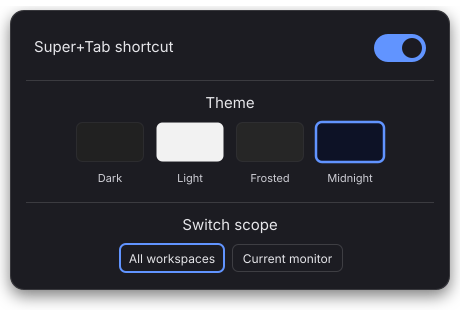

<p align="center">
  
</p>

# cosmic-ext-app-switcher

A macOS-style horizontal app switcher for the [COSMIC desktop](https://system76.com/cosmic) on Pop!_OS — replacing the default vertical Super+Tab list with a compact icon strip centered on screen.

<table align="center">
  <tr>
    <td align="center"></td>
    <td align="center"></td>
  </tr>
  <tr>
    <td align="center"><em>Super+Tab switcher overlay</em></td>
    <td align="center"><em>Panel applet: shortcut, theme and scope</em></td>
  </tr>
</table>

---

## Install

**One-line (no Rust required):**

```bash
curl -fsSL https://raw.githubusercontent.com/j0rdiun/cosmic-ext-app-switcher/main/install.sh | bash
```

**Or build from source:**

```bash
# Install dependencies (one-time)
sudo apt install libxkbcommon-dev
curl --proto '=https' --tlsv1.2 -sSf https://sh.rustup.rs | sh -s -- -y && source ~/.cargo/env

git clone https://github.com/j0rdiun/cosmic-ext-app-switcher
cd cosmic-ext-app-switcher
make install
```

Changes take effect immediately — no logout required.

> ### Not available from the COSMIC Store
>
> A Flatpak build was listed in the COSMIC Store from August to September 2026. It never
> worked, and cannot be made to work. cosmic-comp only offers
> `zcosmic_toplevel_info_v1`, `zcosmic_toplevel_manager_v1` and `zwlr_layer_shell_v1` to
> clients without a Wayland security context, and Flatpak always attaches one, so a
> sandboxed build can neither list your windows nor draw the overlay. Super+Tab silently
> does nothing. Measurements are in
> [#10](https://github.com/j0rdiun/cosmic-ext-app-switcher/issues/10); System76 confirmed
> there is no path for it today in
> [cosmic-comp#2734](https://github.com/pop-os/cosmic-comp/issues/2734#issuecomment-5293857795), and are planning
> configurable `cosmic-session` components to allow it in future.
>
> The listing was withdrawn in
> [cosmic-flatpak#268](https://github.com/pop-os/cosmic-flatpak/pull/268), and existing
> installs are now marked end-of-life. **Use the install script above.**
>
> If you installed it from the store before then, uninstalling leaves Super+Tab dead, because
> the shortcut it registered outlives the app and COSMIC does not fall back to its built-in
> switcher. To clean up:
>
> ```bash
> flatpak uninstall io.github.cosmic-ext-applet-app-switcher
> curl -fsSL https://raw.githubusercontent.com/j0rdiun/cosmic-ext-app-switcher/main/uninstall.sh | bash
> ```
>
> The second command rewrites COSMIC's shortcut config and restores the default switcher.
> It is safe to run whether or not the native version is installed.

---

## Uninstall

```bash
curl -fsSL https://raw.githubusercontent.com/j0rdiun/cosmic-ext-app-switcher/main/uninstall.sh | bash
```

Or from the project directory:

```bash
make uninstall
```

---

## Usage

| Shortcut | Action |
|---|---|
| Super+Tab / Alt+Tab | Open switcher / cycle forward |
| Super+Shift+Tab / Alt+Shift+Tab | Cycle backward |
| Modifier release | Activate selected window |
| Escape | Cancel — return to original window |
| Click icon | Select |
| Release click | Activate |

---

## Which windows are listed

By default the switcher lists every window. The panel applet can narrow that to the monitor you're working on, and `--scope` overrides the applet setting for one invocation:

```bash
cosmic-ext-app-switcher --scope all              # every window (default)
cosmic-ext-app-switcher --scope current-monitor  # only this monitor's windows
```

### Different scopes for Alt+Tab and Super+Tab

COSMIC routes both shortcuts through the same `WindowSwitcher` action, so they can't differ on their own. Giving Alt+Tab its own scope means binding it to a command instead, in `~/.config/cosmic/com.system76.CosmicSettings.Shortcuts/v1/custom`:

```ron
    (modifiers: [Alt], key: "Tab"): Spawn("/home/YOU/.local/bin/cosmic-ext-app-switcher --scope current-monitor"),
    (modifiers: [Alt, Shift], key: "Tab"): Spawn("/home/YOU/.local/bin/cosmic-ext-app-switcher --scope current-monitor --reverse"),
```

Add those inside the existing `{ }`, with your own home directory in the paths. A custom binding overrides COSMIC's default for the same keys, and cosmic-comp reloads the file as you save it. Super+Tab keeps using the applet's setting.

One limit: the scope belongs to the switcher that's already open. Holding Alt and pressing Tab again cycles the open switcher rather than reopening it, so a second shortcut with a different scope only takes effect once you've released the first.

---

## Panel applet

> **Tip:** After installing, right-click your COSMIC panel → **Edit Panel** → **Add Applet** → search for **App Switcher Settings** and add it. This gives you a one-click toggle and theme picker directly in your panel.

Add the **App Switcher Settings** applet to your COSMIC panel for quick access to:
- **Super+Tab shortcut** toggle — enable or disable without touching the terminal
- **Theme picker** — Dark, Light, Frosted, or Midnight

## Enable / Disable

Via the panel applet toggle, or from the terminal:

```bash
make enable         # register as COSMIC window switcher (live reload)
make disable        # remove — restores COSMIC's default switcher
make status         # show current state
make check-compat   # verify COSMIC environment is compatible
```

---

## How it works

COSMIC's compositor (`cosmic-comp`) lets you override the `WindowSwitcher` action by pointing a config file at any binary. The scripts detect the config path automatically — if COSMIC updates and moves to a new config version, it still works.

Each key press launches the binary fresh. The first invocation creates a layer-shell overlay and binds a Unix socket. Subsequent presses (while the modifier is held) connect to that socket and send a `next`/`prev` signal — the running instance advances the selection and re-renders. Releasing the modifier triggers window activation via `zcosmic_toplevel_manager_v1`.

**Wayland protocols used:**
- `zcosmic_toplevel_info_v1` — enumerate open windows
- `zcosmic_toplevel_manager_v1` — activate a window
- `zwlr_layer_shell_v1` — overlay surface centered on screen

These are COSMIC-specific or privileged, and a COSMIC update could remove or change them. Run `cosmic-ext-app-switcher --check-compat` (or `make check-compat`) to see whether your compositor still offers them. If one is missing, Super+Tab does nothing and the switcher logs the reason, which you can find with `journalctl --user -b | grep app-switcher`.

---

## Project structure

```
src/
  main.rs      # entry point: IPC check, then launch app
  app.rs       # libcosmic Application: state machine, socket subscription
  ui.rs        # horizontal icon strip view
  wayland.rs   # background thread: enumerate toplevels, activate window
  icons.rs     # app_id → icon name via .desktop file lookup
scripts/
  find-config.sh   # detects COSMIC shortcuts config path dynamically
  enable.sh        # writes WindowSwitcher entries to COSMIC config
  disable.sh       # removes them
  status.sh        # prints current state
install.sh     # standalone installer (downloads binary, no Rust needed)
uninstall.sh   # standalone uninstaller
.github/
  workflows/
    release.yml    # builds x86_64 + aarch64 binaries on tag push
```

---

## Releasing a new version

```bash
git tag v0.2.0
git push origin v0.2.0
```

GitHub Actions will build binaries for x86_64 and aarch64 and publish a release automatically.

---

## Requirements

- Pop!_OS with COSMIC desktop
- x86_64 or aarch64 architecture

Building from source additionally requires `libxkbcommon-dev` and Rust.

---

## License

GPL-3.0-only — see [LICENSE](LICENSE)
